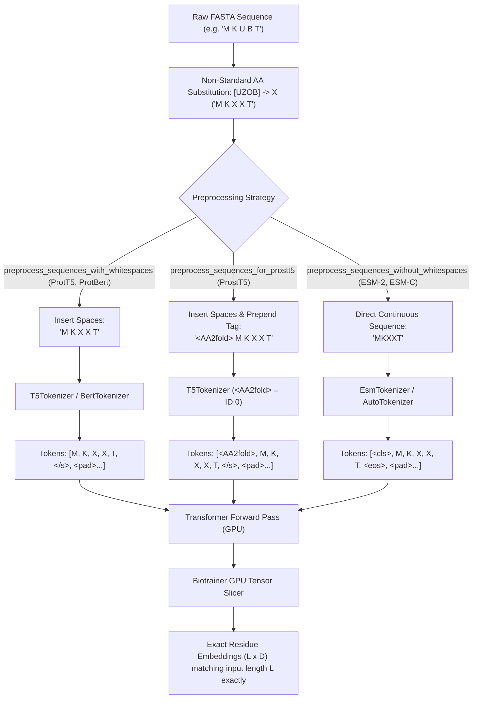

Protein Language Models (pLMs) leverage self-supervised learning on billions of evolutionary amino acid sequences to produce high-dimensional representations (embeddings) of protein sequences. In *biotrainer*, a dedicated set of **biotrainer-optimized embedders** (`BioOptEmbedder`) is natively integrated to maximize throughput, minimize GPU VRAM footprint, and eliminate common tokenization pitfalls in bioinformatics pipelines.

This page provides an in-depth reference for (bio)informaticians detailing every optimized model, their underlying neural architectures (grouped and visualized by architectural family), tokenization strategies, and tensor extraction mechanics.

---

## Overview of Optimized Models

Biotrainer provides specialized, high-throughput embedder implementations for five major protein language model families. When one of these model identifiers is specified in a configuration file or Python script, biotrainer automatically detects and instantiates the optimized pipeline.

| Model / Family | Hugging Face Link | Architecture Family | Tokenizer Type | Preprocessing Strategy |
| :--- | :--- | :--- | :--- | :--- |
| **ProtT5** | [ProtT5 XL UniRef50](https://huggingface.co/Rostlab/prot_t5_xl_uniref50) | T5 Relative-Position Encoder | `T5Tokenizer` (SentencePiece) | `with_whitespaces` |
| **ProstT5** | [ProstT5](https://huggingface.co/Rostlab/ProstT5) | T5 Relative-Position Encoder (Bilingual AA/3Di) | `T5Tokenizer` (SentencePiece) | `for_prostt5` (`<AA2fold>`) |
| **ProtBert** | [ProtBert](https://huggingface.co/Rostlab/prot_bert) | BERT Bidirectional Encoder | `BertTokenizer` (WordPiece) | `with_whitespaces` |
| **ESM-2** | [ESM-2 650M](https://huggingface.co/facebook/esm2_t33_650M_UR50D) | RoPE Transformer Encoder | `EsmTokenizer` (Character BPE) | `without_whitespaces` |
| **ESM-C** | [ESM-C 600M](https://huggingface.co/biohub/ESMC-600M) | RoPE Transformer Encoder (Modernized) | `AutoTokenizer` (ESMC) | `without_whitespaces` |
---

## Architectural Families

The optimized models in biotrainer belong to three primary architectural paradigms:
1. **T5 Relative-Position Encoder** (used by *ProtT5* and *ProstT5*)
2. **BERT Bidirectional Encoder** (used by *ProtBert*)
3. **RoPE-based Transformer Encoder** (used by *ESM-2* and *ESM-C*)

### 1. T5 Relative-Position Encoder Family (ProtT5 & ProstT5)

Both **ProtT5** and **ProstT5** utilize an encoder-only derivation of Google's Text-to-Text Transfer Transformer (T5) architecture. Unlike standard transformers with fixed sinusoidal or learned absolute position embeddings, T5 uses **relative position biases** added directly to attention logits:

```text
Attention(Q, K, V) = softmax((Q * K^T) / sqrt(d_k) + B_rel) * V
```

where `B_rel` assigns positional buckets based on pairwise residue distance `|i - j|`, granting translation-invariance along protein sequences and superior generalization to variable protein lengths.

#### ProtT5
- **Pretraining**: Denoising span corruption objective (masking random continuous spans of amino acids) on UniRef50 (~45 million protein sequences).
- **Encoder vs Encoder-Decoder**: In biotrainer, only the encoder stack (`T5EncoderModel`) is evaluated, saving ~50% GPU memory while outputting 1024-dimensional per-residue vectors.
- **Half Precision**: Available in both standard float32 and natively half-precision checkpoints (`Rostlab/prot_t5_xl_half_uniref50-enc`).

#### ProstT5
- **Bilingual Structure-Sequence Encoding**: ProstT5 shares the identical 24-layer T5 encoder architecture with ProtT5, but was trained bilingually on 1D amino acid sequences (UniRef50) and 3D backbone structural states translated into the 3Di structural alphabet from Foldseek.
- **Directional Prompting**: By prefixing the input with the control token `<AA2fold>`, ProstT5 is prompted into sequence-to-structure representation mode, capturing tertiary structural features directly in its latent embeddings without requiring experimental 3D structures.

---

### 2. BERT Bidirectional Encoder Family (ProtBert)

**ProtBert** adapts the classical BERT (Bidirectional Encoder Representations from Transformers) architecture to protein sequences. It uses **learned absolute position embeddings** combined with token embeddings, followed by a stack of bidirectional self-attention blocks with GeLU activations.

- **Pretraining**: Masked Language Modeling (MLM), where 15% of the amino acid tokens in a sequence are randomly masked (`[MASK]`), corrupted, or kept, and the model predicts the original residue.
- **Training Corpus**: Big Fantastic Database (BFD, >2.1 billion sequences) and UniRef100.
- **Parameters**: 30 layers, 16 attention heads, 1024 hidden dimension (~420M parameters).

---

### 3. RoPE Transformer Encoder Family (ESM-2 & ESM-C)

Meta AI's **ESM-2** and EvolutionaryScale / CZ Biohub's **ESM-C** employ a modern Transformer encoder architecture featuring **Rotary Position Embedding (RoPE)**. 

RoPE applies a rotation matrix to the query (`q`) and key (`k`) vectors at sequence position `m`:

```text
q_m_rot = R(m) * q_m
k_n_rot = R(n) * k_n
dot_product(q_m_rot, k_n_rot) = q_m^T * R(n - m) * k_n
```

Because the dot product depends strictly on relative displacement `(n - m)`, RoPE naturally encodes evolutionary residue-residue interactions and spatial contact geometry directly in the attention maps, while avoiding the memory footprint of quadratic relative bias matrices.

#### ESM-2 Model Sizes

ESM-2 is available in 6 architectural scales, balancing computational budget against representational capacity:

| Model Identifier | Parameters | Layers | Attention Heads | Embedding Dim (`d_model`) |
| :--- | :--- | :--- | :--- | :--- |
| `facebook/esm2_t6_8M_UR50D` | 8 Million | 6 | 20 | 320 |
| `facebook/esm2_t12_35M_UR50D` | 35 Million | 12 | 20 | 480 |
| `facebook/esm2_t30_150M_UR50D` | 150 Million | 30 | 20 | 640 |
| `facebook/esm2_t33_650M_UR50D` | 650 Million | 33 | 20 | 1280 |
| `facebook/esm2_t36_3B_UR50D` | 3 Billion | 36 | 40 | 2560 |
| `facebook/esm2_t48_15B_UR50D` | 15 Billion | 48 | 40 | 5120 |
#### ESM-C (Evolutionary Scale Modeling Cambrian)

The **ESM-C** series (`biohub/ESMC-300M`, `biohub/ESMC-600M`, `biohub/ESMC-6B`) upgrades the RoPE Transformer encoder architecture with innovations from modern LLM architectures:
- **RMSNorm**: Replaces standard LayerNorm with Root Mean Square Normalization for faster compute and numerical stability.
- **SwiGLU Activation**: Replaces standard GELU feedforward layers with Swish-Gated Linear Units, increasing capacity per parameter.
- **Curated Multi-Trillion Token Pretraining**: Pre-trained on broader evolutionary datasets spanning diverse taxonomic clades and metagenomic catalogs.

---

## Tokenizer Mechanics & Sequence Preprocessing

In computational biology, tokenization differences between models represent a major source of silent downstream bugs (e.g., unexpected token splitting, vocabulary mismatches on non-standard amino acids, or misalignment between embedding vectors and original sequence indices).

Biotrainer solves this via automated, model-specific **preprocessing strategies** and **tokenization mixins** (`BiotrainerTokenizerMixin`).



### 1. Handling Non-Standard Amino Acids
All optimized embedders automatically sanitize raw inputs by replacing non-standard or ambiguous residues (`U` for Selenocysteine, `Z` for Glutamic acid/Glutamine, `O` for Pyrrolysine, `B` for Aspartic acid/Asparagine) with `X` (unknown residue) using regular expressions:

```python
sequences_cleaned = [re.sub(r"[UZOB]", "X", sequence) for sequence in sequences]
```

This prevents unexpected sub-word splits and token index corruption.

### 2. Preprocessing Strategies

#### Strategy A: `preprocess_sequences_with_whitespaces` (ProtT5, ProtBert)
- SentencePiece and WordPiece tokenizers were originally trained with whitespace delimiters.
- Residues are separated by spaces: `"M A L S L ..."` (while preserving existing mask tokens like `[MASK]` or `<extra_id_0>`).
- Token sequence generated:
  - **ProtT5**: `[AA1, AA2, ..., AAn, </s>, <pad>, ...]`
  - **ProtBert**: `[[CLS], AA1, AA2, ..., AAn, [SEP], [PAD], ...]`

#### Strategy B: `preprocess_sequences_for_prostt5` (ProstT5)
- Adds spaces between residues and prepends `<AA2fold>`: `"<AA2fold> M A L S L ..."`.
- Token sequence generated:
  - `[<AA2fold> (token index 0), AA1, AA2, ..., AAn, </s>, <pad>, ...]`

#### Strategy C: `preprocess_sequences_without_whitespaces` (ESM-2, ESM-C)
- Tokenizers use a dedicated single-character vocabulary. No spaces are inserted.
- Input sequence: `"MALSL..."`.
- Token sequence generated:
  - `[<cls>, AA1, AA2, ..., AAn, <eos>, <pad>, ...]`

### 3. Special Tokens & Mask Tokens

| Model | Beginning of Sequence (BOS) | End of Sequence (EOS) | Mask Token (MLM) | Padding Token | Custom Prefix |
| :--- | :--- | :--- | :--- | :--- | :--- |
| **ProtT5** | *None* | `</s>` (ID: 1) | `<extra_id_0>` | `<pad>` (ID: 0) | *None* |
| **ProstT5** | `<AA2fold>` | `</s>` (ID: 1) | `<extra_id_0>` | `<pad>` (ID: 0) | `<AA2fold>` |
| **ProtBert** | `[CLS]` (ID: 2) | `[SEP]` (ID: 3) | `[MASK]` (ID: 4) | `[PAD]` (ID: 0) | *None* |
| **ESM-2** | `<cls>` (ID: 0) | `<eos>` (ID: 2) | `<mask>` (ID: 32) | `<pad>` (ID: 1) | *None* |
| **ESM-C** | `<cls>` | `<eos>` | `<mask>` | `<pad>` | *None* |

---

## Usage Example

```python
import torch
from biotrainer.embedding import get_embedding_service

# Initialize optimized embedder service
service = get_embedding_service(
    embedder_name="facebook/esm2_t33_650M_UR50D",
    custom_tokenizer_config=None,
    use_half_precision=True,
    device="cuda" if torch.cuda.is_available() else "cpu",
)

sequences = [
    "MKTVRQERLKSIVRILERSKEPVSGAQLAEELSVSRQVIVQDIAYLRSLGYNIVATPRGYVLAGG",
    "MALLSLLALVLLALPAGSAGPVPTPGQLAQEVTRLLEQ",
]

# Compute per-residue embeddings
# Each embedding tensor has shape (L, 1280) matching exact sequence length L
embeddings = list(service.compute_embeddings(sequences))

for idx, emb in enumerate(embeddings):
    print(f"Sequence {idx + 1}: length={len(sequences[idx])}, embedding shape={emb.shape}")
```

---

## References & Further Reading

- **ProtT5 & ProtBert**: Elnaggar et al., *"ProtTrans: Towards Cracking the Language of Life's Code Through Self-Supervised Deep Learning and High Performance Computing"*, IEEE TPAMI 2021. [DOI: 10.1109/TPAMI.2021.3095381](https://doi.org/10.1109/TPAMI.2021.3095381)
- **ProstT5**: Heinzinger et al., *"ProstT5: Bilingual Language Model for Protein Sequence and Structure"*, Nucleic Acids Research 2023. [DOI: 10.1093/nar/gkad1148](https://doi.org/10.1093/nar/gkad1148)
- **ESM-2**: Lin et al., *"Evolutionary-scale prediction of atomic-level protein structure with a language model"*, Science 2023. [DOI: 10.1126/science.ade2574](https://doi.org/10.1126/science.ade2574)
- **ESM-C**: EvolutionaryScale & Chan Zuckerberg Biohub, *"ESM Cambrian: Scaling open protein language models"*, 2024. [GitHub Repository](https://github.com/Biohub/esm)
- **Biotrainer Repository**: [github.com/sacdallago/biotrainer](https://github.com/sacdallago/biotrainer)
